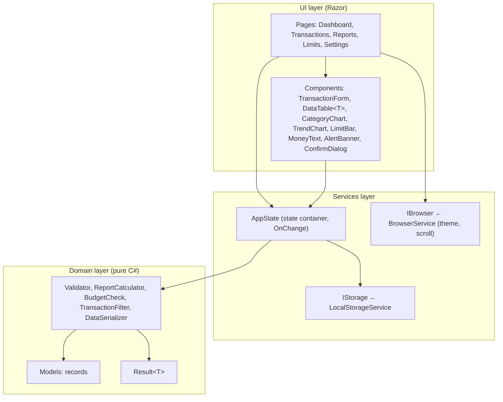
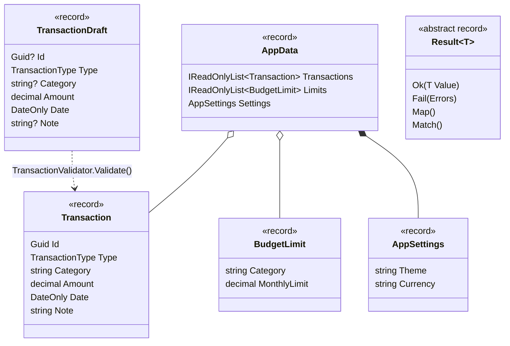
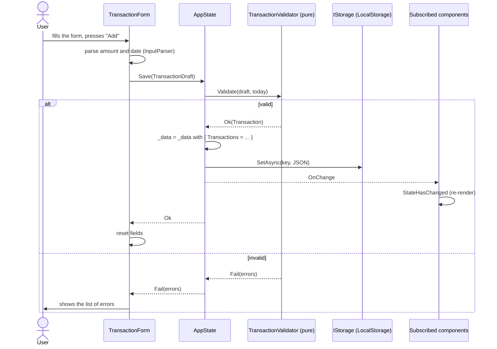

# Architecture

Budget Tracker has three layers. Dependencies point one way only: **UI → Services → Domain**.
Domain knows nothing about Blazor or the browser.

## Domain model

## Flow: adding a transaction

## Key design decisions

| Decision | Reason |
|---|---|
| One immutable `AppData` snapshot, replaced on every change | No hidden mutation; easy to reason about, serialize and test |
| `Result<T>` instead of exceptions for invalid input | Failure is an expected outcome, so it is part of the return type and cannot be forgotten |
| Domain as a separate project | Enforces "no UI in logic"; tests run without a browser; storage or UI can change independently |
| `IStorage` and `IBrowser` interfaces | Tests use `FakeStorage`; LocalStorage could later be replaced by an API without touching components |
| Source-generated JSON (`AppJsonContext`) | No runtime reflection, safe with Blazor trimming, faster start-up |
| `AppStateComponent` base class | One place for subscribe/unsubscribe, so no component can leak an event handler |
| `CascadingValue<AppSettings>` | Currency and theme reach every `MoneyText` without parameter passing |
| Templated `DataTable<TItem>` | The table skeleton (empty state, paging) is written once; callers decide the columns |
| Plain CSS and SVG, no libraries | Nothing extra to download, full control of responsive behaviour |

## Mapping to the grading criteria

| Criterion | Where to look |
|---|---|
| Code Structure and Design | Three projects; `Domain/Logic/*`; records and pure functions |
| Component Reusability | `TransactionForm` (parameters + callbacks), `DataTable<TItem>`, `MoneyText`, `LimitBar`, `ConfirmDialog` |
| Cross-Platform | Runs in any modern browser; QA matrix in [QA.md](QA.md) |
| State Management | `AppState`, `AppStateComponent`, `AppSettingsProvider` (cascading value) |
| UI / UX | `wwwroot/css/app.css`, empty states, confirmation dialogs, light/dark theme |
| Responsiveness | `@media` breakpoints at 900 px and 700 px; bottom navigation and card-style tables on phones |
| Core Functionality | Transactions, reports, limits, settings |
| Advanced Features | Category limits with 80% warning, 6-month trend chart, validation with `Result<T>` |
| Error Handling | `Result<T>`, corrupted-data backup, storage failure banner |
| Efficiency / Resources | `@key`, paged `DataTable`, no chart library, source-generated JSON, trimmed WASM build |
| Scalability | Storage behind `IStorage`; Domain independent of UI |
| Testing | `tests/BudgetTracker.Tests`: xUnit for Domain and `AppState`, bUnit for components |
| Quality Assurance | [QA.md](QA.md) checklist and device matrix |
| Documentation | README, this file, USER_GUIDE, QA |
| Innovation / Creative use | SVG charts built by hand, templated components, cascading settings |
| Professionalism | CI pipeline, consistent structure, accessible markup |
